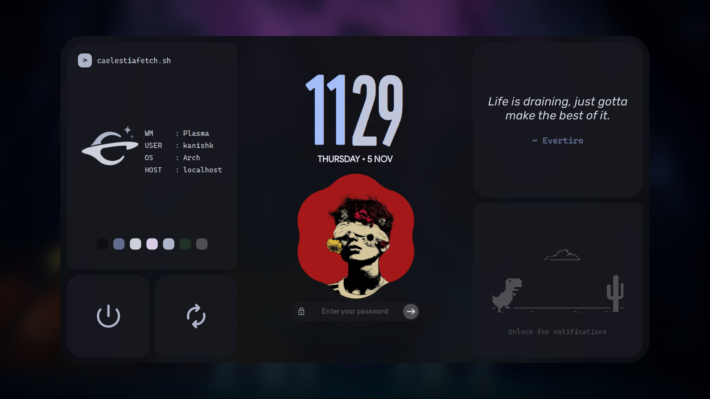

# Caelestia SDDM

A clean, modern SDDM login screen with custom wallpaper and avatar.



---

## 🚀 Install

```bash
git clone https://github.com/Kanishkchahar/caelestia-sddm.git
cd caelestia-sddm
./install.sh
```

The installer will interactively ask you to:
1. **Set your display name** — shown in the greeting (e.g. *"Good morning, Kanishk"*)
2. **Choose a wallpaper** — pick any image from your system, or press Enter for the included default
3. **Choose a profile picture** — pick any image, or press Enter for the included default

It then handles dependencies, fonts, SDDM configuration, and permissions automatically.

---

## 🖥️ Preview

Test the theme in a window without rebooting:

```bash
./install.sh preview
```

## 🗑️ Uninstall

```bash
./install.sh uninstall
```

---

## 🎨 Customization

After installing, you can re-run `./install.sh` anytime to change your wallpaper, avatar, or display name.

Or edit manually:
- **Wallpaper:** Replace `assets/background.jpg`
- **Avatar:** Replace `assets/avatar.jpg`
- **Colors & UI:** Edit `theme.conf`

---

## 📦 Requirements

- `sddm`, `qt6-declarative`, `qt6-5compat`, `qt6-svg`, `qt6-multimedia`
- Fonts: `ttf-material-symbols-variable`, `ttf-roboto`, `ttf-cascadia-code-nerd`, `ttf-rubik-vf`

> All dependencies are auto-installed by `./install.sh` on Arch Linux.
